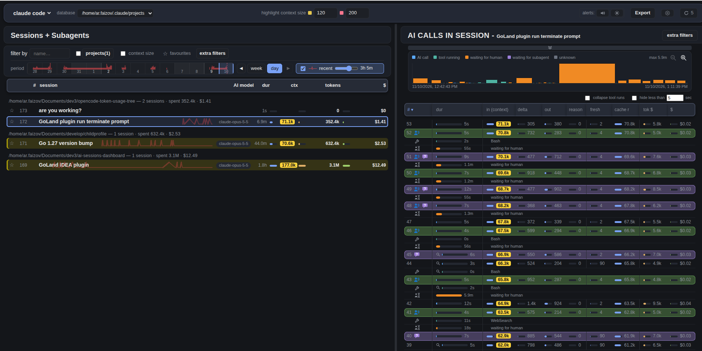
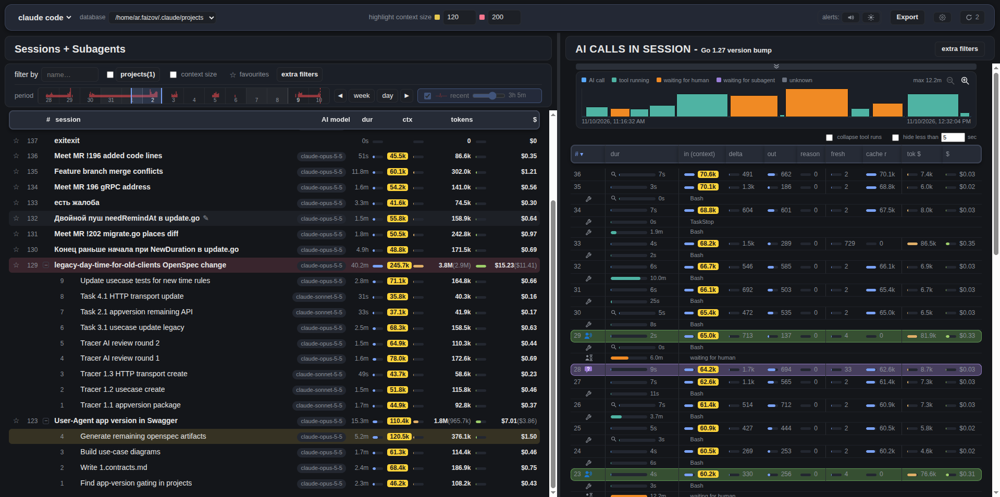
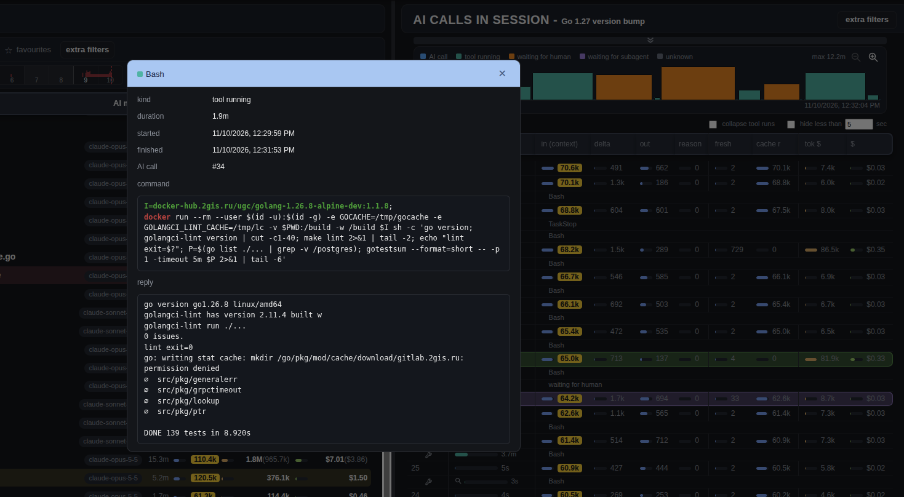

# AI Sessions Dashboard

[](https://github.com/artur-faizov/AI-sessions-dashboard/releases/latest)
[](https://plugins.jetbrains.com/plugin/35961-ai-sessions-dashboard)

See where your tokens go: a local, read-only dashboard of **Claude Code** and **Codex**
sessions (also OpenCode and GitHub Copilot CLI) with every subagent, its context size,
tokens spent and estimated cost.



## Features

- **One tree for all agents** — sessions grouped by project, subagents nested to any depth
- **Per session** — model, duration, max context size, tokens spent, cost at prices you set
- **Per AI call** — context growth, cache hits and misses, the prompt or tool result that triggered it
- **Live alerts** — sound and a blinking row when an agent asks a question, waits for a
  permission or has finished
- **Private** — reads the agents' local session files read-only; nothing leaves your machine

## Install

**Standalone** — download the binary for your OS from the
[latest release](https://github.com/artur-faizov/AI-sessions-dashboard/releases/latest) and run it:

```bash
# macOS (Apple Silicon); for Linux use dashboard-lin-x64 or dashboard-lin-arm64
curl -L -o dashboard https://github.com/artur-faizov/AI-sessions-dashboard/releases/latest/download/dashboard-mac-darwin
chmod +x dashboard
./dashboard
```

On Windows download and run `dashboard.exe`.

**JetBrains IDE** (IntelliJ IDEA, PyCharm, GoLand, … 2023.3+) — Settings → Plugins →
Marketplace → search for
[AI Sessions Dashboard](https://plugins.jetbrains.com/plugin/35961-ai-sessions-dashboard),
then open the *AI Sessions* tool window on the right.

**From source** (Go 1.26+):

```bash
go run ./cmd/dashboard
```

## Usage

Run it — the dashboard opens at http://localhost:8787 and finds your sessions by itself.
There is nothing to configure and no hooks to install in the agents.

1. Pick a session in the tree on the left; expand it to see its subagents.
2. The panel on the right lists every AI call of that session.
3. Click a call to see what triggered it: your prompt, or the tool command and its result.





Use **Filter** to narrow sessions by name, model, date, context or tokens, and the gear
icon for prices, alert sounds and data sources.

| Agent | Data it reads |
| --- | --- |
| Claude Code | `~/.claude/projects` |
| Codex (CLI, IDE, desktop) | `~/.codex` (`CODEX_HOME`) |
| OpenCode | `opencode.db` (auto-detected, or `--db <path>`) |
| GitHub Copilot CLI | `~/.copilot` (`COPILOT_HOME`) |

Options: `PORT=9000` sets the port, `--provider claude,codex` shows only the named agents.

## Documentation

- [Reference](docs/REFERENCE.md) — columns and numbers explained, alerts, building
  binaries and the plugin, per-provider details
- [Herdr panel](herdr/RECIPE.md) — the `ai-sessions` mod for [Herdr](https://herdr.dev)

## License

[MIT with the Commons Clause](LICENSE.md) — free to use, including at work; selling the
software is not allowed.
