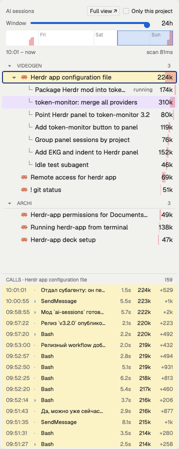

# AI sessions

A side panel that lists the Claude Code and Codex CLI sessions active in a time span you
pick, newest first, grouped by project, each with its subagents nested below; red bands
show when each one was calling the model, and big contexts tint their row. Click a row
to see its API calls; "Full view" opens the same session in the token-monitor dashboard.

## What you see

Top to bottom, in a block 320px wide (theme `chrome` background, 13px text, 4px padding):

- **Header row** (11px): "AI sessions" in `muted`, a "Full view ↗" button (1px `border`,
  3px radius, `hover` background) and an "Only this project" checkbox (12px box, `accent`
  when on).
- **Window slider**: "Window", a slider (4px `border` track, `accent` range, 12px
  `accent` thumb) and the span in semibold (`5m` … `24h`, e.g. `2h40m`).
- **Timeline** (30px, `surface`, 3px radius, 8px side margin): the last 3 days. Day
  boundaries are 1px `border` lines with the weekday (`Fri`, 10px `dim`); red bars
  (`#e5484d` at 45%) are API calls per 30-minute bucket (height = sqrt share of the
  busiest bucket, at least 8%); the selected span is an `accent` box at 18% fill with an
  80% 1.5px edge.
- **Span line** (11px `muted`): `9:41 – now` (or an end time), `· <project>` when "Only
  this project" is on, and `scan 31ms` on the right.
- **Tree**: per project a header (10px `muted` caps, chevron, count, 1px `border`
  underline), then one 18px line per session: chevron (when it has subagents), the
  Claude or Codex icon (13px), the title (semibold, truncated), and the context in
  thousands (`219k`, semibold, 34px right-aligned). Subagents sit 28px deeper after `└`,
  with their type (unless `general-purpose`) and `running` in 11px `muted`.
  Rows with context over 200k are tinted `#fbf3c6` (dark: `#3d3820`), over 300k
  `#ece2fb` (dark: `#3a2d55`). Red bands (`#e5484d` at 32%) cover each API call from
  send to finish across the row, merged when they overlap; an in-flight call runs to now.
  At most 50 sessions. "No sessions in this span" when empty.
- **Calls pane** (only while a row is selected, below a 7px draggable divider):
  `CALLS · <title>` and the count, then one 11px line per call, newest first: time
  (`09:44:56`), `›` (`accent`, a prompt started it) or `·` (a tool result did), what it
  did (tool names with `×n`, else the reply's first text, else `(thinking)`; `in
  flight…` in `working` for a running call), duration (`3.9s`, `1m05`), context and its
  growth over the previous call (`+2k`, `blocked` color over 20k).

## How it behaves

- Rescans every 5 s. A session shows when it or a subagent had an API call inside the
  span; sessions sort by their latest call in the span, groups by their newest session.
- Window slider: log scale 5 min … 24 h. Timeline: press and drag to move the span (a
  press inside keeps the grab offset, outside centres it); dragging back to the right
  edge pins it to now again. Span, pin, "only" and the split are remembered.
- "Only this project": keeps the sessions of the focused terminal's folder (or its
  space's folder), matched to Claude's project dir naming (every non-alphanumeric
  character becomes `-`; a subfolder belongs to the longest matching project).
- Chevrons fold a project or a session's subagents (folded projects are remembered).
- Clicking a row selects it (2px `#1e3a8a` frame; hover shows a 1px frame) and opens
  its calls; clicking it again closes them. Clicking a call marks it.
- **Full view ↗**: opens token-monitor in the browser at the selected session
  (`<url>/#session=claude:<id>`, `claude:agent-<id>` for a subagent, `codex:<thread>`).
  token-monitor runs in a Herdr tab named `token-monitor` (closing the tab stops it),
  started once and reused. The binary is `token-monitor` on `PATH`, else
  `~/.cache/ai-sessions/token-monitor`, else the latest release asset of
  github.com/artur-faizov/AI-sessions-dashboard for this OS/arch is downloaded there
  first (a toast says so). No release, no asset for this platform, or a failed download:
  an error toast says what to do.
- Keys (this folder's `keys.json`): `cmd-shift-s` / `ctrl-shift-s` run
  `layout.toggle:ai-sessions` (hide/show the panel). Bindable mod commands:
  `ai-sessions.full` (the Full view button), `ai-sessions.calls` (select the top session).

## Built from

- `mods/ai-sessions/`: `main.js` (the panel), `scan.js` (the transcript scanner),
  `dashboard.js` (Full view), `mod.json`
  (`{"place": "right", "size": 320, "title": "AI sessions", "overlay": {"kind": "dialog", ...}}`),
  `icon.svg`. Provider icons are Herdr's shipped `icons/claude.svg` and `icons/codex.svg`.
- The block: Herdr docks it into the shown layout on first sight. For the toggle key,
  give that block `"id": "ai-sessions"` (Herdr names it with a random id), e.g.
  `{ "id": "ai-sessions", "type": "block", "size": { "px": 320 }, "min": 220, "max": 700, "content": { "mod": "ai-sessions" } }`.
- `herdr` functions: `exec`, `hc` (`ls --json`, `label`, `read`), `run("tab.new")`,
  `notify`, `nextCommand`, `readTextFile`, `home`, `theme`, `settings`, `focused`,
  `spaces`; `fs/promises` (`readdir`, `exists`), `fetch` (GitHub API), `localStorage`.
- Programs it runs: `find … -exec stat` (one per scan, lists `*.jsonl` changed in 3 days
  under `~/.claude/projects` and `$CODEX_HOME/sessions` or `~/.codex/sessions`),
  `sh -c 'dd … count=0; head -c …'` (reads only the bytes appended since the last scan),
  `printenv CODEX_HOME`, `curl` (download), `open`/`xdg-open`, token-monitor itself.
  On Windows: PowerShell `Get-ChildItem` for the listing and whole-file reads.
- Scanner rules (token-monitor's): Claude context = input + cache_read +
  cache_creation of the last real assistant message; one beat per `requestId`, sent =
  the last user line before it; titles from `custom-title` / `ai-title`, else
  `last-prompt`. Codex: one call per unique `token_usage_record.response_id`
  (`event_msg/token_count` only when a file has no such records), context =
  `input_tokens`, children nest under `parent_thread_id`. A trailing input line in a
  transcript changed in the last 5 min is an in-flight call.

## Watch out

- This mod reads files outside its folder (`~/.claude`, `~/.codex`), runs programs, and
  reaches the network (GitHub API and release download) only when Full view needs a
  binary.
- Herdr's `fs` has no stat or offset reads and `readTextFile` stops at 1 MiB, so the
  scanner lists with `find`/`stat` and reads with `dd`+`head` through `exec` (8 MiB
  output cap: reads go in 6 MiB chunks). Not `tail -c +N`: on macOS it is ~20 ns per
  byte. Parse state lives in memory only, so the first scan after Herdr starts reads
  the last 3 days once (about 0.35 s for 50 MB); later scans read only appended bytes.
- Never write caches under `mods/`: every write there hot-reloads the mod.
- The dashboard's GitHub repo must be public and have a release for the download.
- Windows paths (PowerShell listing, `cmd` start) and Linux `stat -c` are untested.

## Done when

- `herdr-app check ~/.config/herdr-app/mods/ai-sessions` passes and `herdr-app status`
  shows no errors.
- The panel lists the sessions you are running now, with their subagents and context;
  the `scan` number stays in tens of ms after the first scan.
- Clicking a session shows its calls, newest first, with tool names and context growth.
- Full view opens the dashboard on that session in a `token-monitor` tab.
- `cmd-shift-s` hides and shows the panel.
